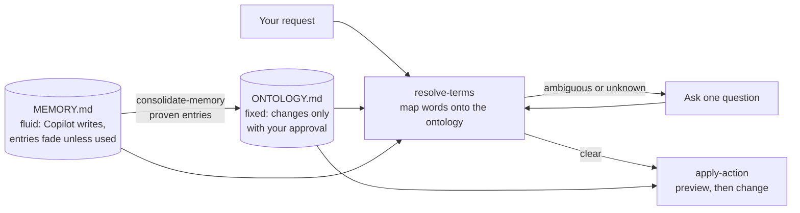

# Copilot-skills: an ontology plugin for GitHub Copilot

[](https://github.com/tesah-bot-accoint/Copilot-skills/actions/workflows/test.yml)
[](./LICENSE)

**Stop Copilot from guessing what you mean.**

Ask an AI coding agent to "close the stale tickets" and it has to guess: which tickets, what counts as stale, close how? This plugin gives Copilot a small, explicit model of your project (an ontology) and a memory that learns from use, so it maps vague requests onto defined terms, asks one sharp question when it can't, and changes things only through actions you've declared.

It's a neurosymbolic setup in miniature. The language model handles the fuzzy part (understanding what you said); a plain Markdown ontology supplies the symbolic part (what words mean and what's allowed).

## How it works

<!-- REVIEW R10 [nit]: The diagram labels ONTOLOGY.md 'fixed: changes only with your approval', but the consolidate-memory arrow into it has no approval step, and the resolve-terms Record path (step 6) isn't drawn. Label the arrow 'proposed, with approval'. -->


Two files per project, with different jobs:

- **`ONTOLOGY.md`, the fixed half.** Modeled on the Palantir Ontology: **Object Types** (the things, with their Properties), **Link Types** (typed relationships) and **Action Types** (the only sanctioned ways to change things, each with parameters, preconditions and effects). Synonyms to avoid and settled ambiguities live here too.
- **`MEMORY.md`, the fluid half.** Corrections, preferences and approaches that worked. Copilot writes it freely. Each entry fades on a forgetting curve unless it keeps being used; the ones that prove themselves are proposed for the ontology.

## Install

<!-- REVIEW R11 [clarify]: Check the install form (plugin install owner/repo), the update and uninstall commands, and the plugin-dir flag against the current Copilot CLI plugin docs before announcing this. The CLI's plugin commands are new and have changed. -->
Requires [GitHub Copilot CLI](https://docs.github.com/copilot/concepts/agents/copilot-cli/about-cli-plugins).

```sh
copilot plugin install tesah-bot-accoint/Copilot-skills
```

Update with `copilot plugin update ontology`; remove with `copilot plugin uninstall ontology`. To try a local checkout without installing, run `copilot --plugin-dir path/to/Copilot-skills`.

The helper scripts need Python 3 (standard library only). Without Python, the skills fall back to applying the same rules by hand.

## Quick start

1. In your project, ask Copilot: **"Set up an ontology for this repo."** It reads your code, drafts `ONTOLOGY.md`, and asks you one question at a time where things are unclear. Or start from the [issue-tracker example](./examples/issue-tracker/ONTOLOGY.md).
2. Ask something vague: **"Close the stale tickets."** Copilot maps "tickets" to Issue, asks what "stale" means if the ontology doesn't say, then runs the Close Issue action with a preview first.
3. Work as usual. When you correct Copilot, it notes the correction in `MEMORY.md`.
4. Now and then, ask: **"Consolidate memory."** Faded entries are dropped and proven ones are offered for the ontology.

## Skills

| Skill | What it does |
| --- | --- |
| [resolve-terms](./skills/resolve-terms/SKILL.md) | Maps a request's nouns and verbs onto `ONTOLOGY.md`, and asks one question instead of guessing when a term is ambiguous or unknown. |
| [apply-action](./skills/apply-action/SKILL.md) | Changes things only through a declared Action Type, after filling its parameters and checking its preconditions. |
| [model-ontology](./skills/model-ontology/SKILL.md) | Creates or extends `ONTOLOGY.md` by reading the code and interviewing you one question at a time. |
| [remember](./skills/remember/SKILL.md) | Records facts, preferences, corrections and working patterns in `MEMORY.md`, and refreshes entries each time they prove useful. |
| [consolidate-memory](./skills/consolidate-memory/SKILL.md) | Scores memory on a forgetting curve, drops what has faded, merges duplicates, and proposes long-lived entries for the ontology. |
| [vet-skill](./skills/vet-skill/SKILL.md) | Quarantines and scans an outside skill for prompt injection and risky capabilities, and installs it only after you approve. |
| [tone-mode](./skills/tone-mode/SKILL.md) | Switches between focused, exploratory, careful and default modes that set how terse, curious and cautious Copilot is. |

## The forgetting curve

Each memory entry records when it was first and last used and how often. Its retention is

```
R = exp(-days since last use / (7 × uses))
```

<!-- REVIEW R12 [should-fix]: Spell out what this means in practice: an entry used once is forgotten about 11 days after its last use (7 x ln 5), after 2 uses about 23 days, after 3 uses about 34 days. These are calendar days, so a project left alone for a month loses most of its memory (see R33). Also, 'at least 3 times over at least 2 days' doesn't match score.py, which needs last minus first of at least 2, which means 3 distinct calendar days. Pick one and align README, SKILL.md and score.py. -->
so every use makes it fade more slowly. Entries below R = 0.2 are forgotten, pinned entries never are, and entries used at least 3 times over at least 2 days are proposed for the ontology. The rule lives in [score.py](./skills/consolidate-memory/score.py) so it gives the same answer every time. Try it on the example:

```sh
python3 skills/consolidate-memory/score.py examples/issue-tracker/MEMORY.md --today 2026-11-15
```

## Safety

- `ONTOLOGY.md` is never changed without your approval, including by consolidation.
- Changes go through declared actions with a preview; destructive or bulk changes wait for confirmation.
- Outside skills go through `vet-skill`: quarantine, a scan for instruction overrides, self-spreading text, hidden characters, pipe-to-shell and network calls ([scan.py](./skills/vet-skill/scan.py)), a full read, and your approval. A clean scan narrows the review; it isn't proof of safety.

## Repo layout

```
.github/plugin/plugin.json      plugin manifest
.github/copilot-instructions.md rules for Copilot when working on this repo
skills/<name>/SKILL.md          the skills, plus templates and helper scripts
examples/issue-tracker/         a worked ONTOLOGY.md and MEMORY.md
ONTOLOGY.md                     this repo's own ontology (the plugin uses its own method)
tests/                          tests for the helper scripts
```

Run the tests with `python3 -m unittest discover -s tests`.

## Credits

- The ontology structure (Object, Link and Action Types) follows the concepts of the [Palantir Foundry Ontology](https://www.palantir.com/docs/foundry/ontology/overview/). This project isn't affiliated with Palantir.
- The fixed-rules versus fluid-memory split, decay-based consolidation and skill quarantine are adapted from ideas shared by the authors of [Bitterbot](https://github.com/Bitterbot-AI/bitterbot-desktop). No code is copied from it.

## License

[MIT](./LICENSE)
